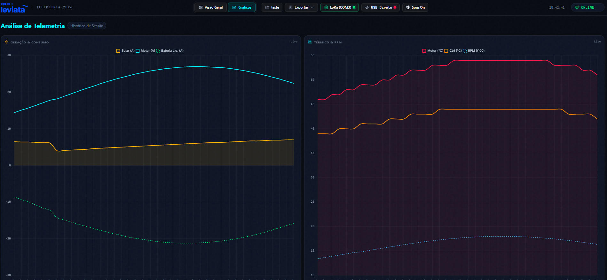

# 🚤 Equipe Leviatã 2026 - Estação Base Web de Telemetria

Sistema moderno de monitoramento em tempo real da telemetria do barco solar da **Equipe Leviatã (UEA)**. Desenvolvido para operação de pista com suporte a conexão Serial USB (ESP32 / LoRa Base), armazenamento local SQLite, transmissão multi-dispositivo via Wi-Fi (Socket.IO) e executável portátil de 1 clique.

---

## 🎬 Preview

### Visão Geral — Dashboard em Tempo Real


### Gráficos de Telemetria


---

## ⚡ Recursos Principais

- **Dashboard Futurista & Responsivo**:
  - **Manômetros Circulares Neumórficos**: Velocidade (km/h), RPM e Potência Solar (W).
  - **Status da Bateria LiFePO4**: Indicador de Carga (SOC %), Tensão em Volts (51.2V), Autonomia Estimada (h) e Saldo de Potência (W).
  - **Mapa da Raia da Prova (GPS)**: Rastreamento em tempo real com Leaflet (OpenStreetMap), marcador em laranja neon do barco com orientação de proa (°), contagem de satélites e registro do trajeto.
  - **Métricas Críticas & Alertas (Fardriver)**: Temperatura do Motor, Temperatura da Caixa Eletrônica (Controlador), Corrente de Consumo e **Histórico de Falhas Fardriver** com registro de eventos e carimbo de data/hora.
  - **Gráfico de Energia em Tempo Real**: Curvas de Entrada Solar (A) vs. Saída Motor (A) atualizados dinamicamente.
  - **Cronômetro do Pit Wall**: Marcação manual de voltas, melhor volta (*Best Lap*) e velocidade média.
- **Portabilidade 100% Autônoma (Sem instalação)**:
  - Inclui Node.js portátil embutido. Basta 2 cliques para rodar em qualquer notebook Windows na pista sem instalar nada.
- **Transmissão Multi-Dispositivo (Wi-Fi)**:
  - Transmite os dados instantaneamente para celulares, tablets e outros notebooks conectados à mesma rede da base.

---

## 🚀 Como Rodar na Pista (1 Clique)

### 🎒 Modo 1: Operação Pista 100% Offline (Sem Internet)
1. Dê **2 cliques** no arquivo original:
   ```cmd
   START_TELEMETRIA.bat
   ```
2. O servidor local será iniciado e o navegador abrirá automaticamente em `http://localhost:3001`. Os dados são gravados localmente no SQLite.

---

### 🌐 Modo 2: Operação Online Distribuída (Computador A & Computador B)

Este modo permite que o **Computador A** seja o servidor público e o **Computador B** seja a estação com o rádio LoRa/ESP32 na pista, com sincronização resiliente (se a internet cair no B, os dados continuam gravados no disco e sincronizam automaticamente ao voltar).

#### Passo 1: No Computador A (Servidor Central)
1. Execute:
   ```cmd
   START_SERVIDOR_ONLINE.bat
   ```
2. Ele iniciará o servidor e o túnel seguro Cloudflare gerando um link público temporário (ex: `https://xxxx.trycloudflare.com`). Se as credenciais de e-mail estiverem configuradas em `backend-node/config_online.json`, o link será enviado por e-mail automaticamente.

#### Passo 2: No Computador B (Estação de Pista com ESP32)
1. Conecte o rádio/ESP32 via USB e execute:
   ```cmd
   START_TELEMETRIA_ONLINE.bat
   ```
2. No painel aberto em `http://localhost:3001`, clique no botão **"Online Sync"** no topo da tela.
3. Cole o link público gerado no Computador A e clique em **Aplicar URL**.
4. Pronto! Os dados são gravados localmente no Computador B e enviados simultaneamente para o Computador A.


---

## 🛠️ Desenvolvedores / Modo de Desenvolvimento

Se quiser editar o código-fonte em tempo de desenvolvimento:

### 1. Iniciar o Backend Node.js
```bash
cd "backend-node"
npm install
node server.js
```

### 2. Iniciar o Frontend React (Vite Hot Reload)
```bash
cd "frontend-react"
npm install
npm run dev
```
Acesse `http://localhost:5173`.

---

## 🛰️ Protocolo Serial JSON (ESP32 / LoRa Base)

A estação base aguarda um payload JSON enviado via Serial (115200 bps) a cada 1 segundo no seguinte formato:

```json
{
  "solar": {
    "tensao": 46.5,
    "corrente": 6.8,
    "pot": 316.2
  },
  "bateria": {
    "soc": 88.5,
    "tensao_bat": 51.2,
    "corrente_liq": -12.4
  },
  "prop": {
    "rpm": 1450,
    "i_motor": 19.2,
    "t_motor": 48.5,
    "t_ctrl": 36.2,
    "fardriver_falha": 0
  },
  "nav": {
    "vel": 21.8,
    "lat": -3.119020,
    "lon": -60.021730,
    "gps_satelites": 12,
    "gps_hora": "15:30:45",
    "proa": 175.4,
    "hdop": 0.95
  },
  "sinal": {
    "lora_pacotes": 1420,
    "lora": -78,
    "lte": 22
  },
  "v_sist": 4.10
}
```

### 💻 Simulador ESP32
Para testar a estação base sem a rádio LoRa física conectada, grave o código `simulador_esp32_serial.ino` em uma placa ESP32. Ela simulará as variações reais do barco navegando na raia de prova em Manaus.

---

## 📂 Estrutura do Projeto

```text
estação base web/
├── START_TELEMETRIA.bat       # Lançador de 1 clique para pista
├── node/                      # Node.js portátil (Windows)
├── backend-node/              # Servidor Node.js, Serial, SQLite3 e Socket.IO
│   ├── server.js              # Ponto de entrada do servidor API/WebSocket
│   ├── serialManager.js       # Gerenciador da porta Serial USB (115200 bps)
│   ├── database.js            # Conexão SQLite (telemetria.db)
│   └── telemetria.db          # Banco de dados SQLite local
└── frontend-react/            # Interface React 19 + Vite
    ├── dist/                  # Build de produção servido pelo Express
    ├── src/
    │   ├── assets/            # Animações Lottie e ícones
    │   ├── components/        # Manômetros, Mapa, Histórico de Falhas, Bateria, Logo
    │   ├── pages/             # DashboardPage e AnalyticsPage
    │   └── index.css          # Design System Neumórfico Dark Mode
    └── package.json
```

---

## 🏆 Equipe Leviatã 2026 - Universidade do Estado do Amazonas (UEA)
*Desenvolvido para máxima confiabilidade, performance e facilidade de operação durante as competições de barcos solares.*
