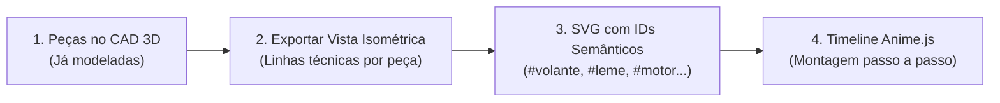

# Telemetria Leviatã 2027: Gêmeo Digital 3D & Site Didático da Montagem

Este documento estabelece o planejamento de viabilidade, arquitetura e engenharia para a **Telemetria 2027** da equipe Leviatã. O projeto é dividido em **duas frentes independentes**, aproveitando os modelos CAD já desenhados pela equipe e respeitando a execução leve em notebooks sem placa de vídeo dedicada (GPU integrada Ryzen 7).

---

## 1. Visão Geral: Divisão em Dois Projetos

Para manter a estação de telemetria enxuta durante a prova e ao mesmo tempo ter uma apresentação didática de alto impacto para bancas, patrocinadores e novos membros, a arquitetura foi separada:

| Projeto | Foco Principal | Rota Gráfica | Onde Roda |
| :--- | :--- | :--- | :--- |
| **Frente 1: Site Didático da Montagem** *(Leviatã Showcase)* | Explicar passo a passo cada subsistema da embarcação, **do volante até o barco completo** | **Rota B: SVG Vetorial + Anime.js** (estilo blueprint/wireframe com traçado a laser) | Site estático independente (GitHub Pages / Vercel), acessível via QR Code no celular ou PC |
| **Frente 2: Gêmeo Digital na Telemetria** *(Estação Base)* | Espelhar o estado físico, térmico e energético do barco **em tempo real** durante a navegação | **Rota A: Barco 3D Completo (glTF simplificado + Three.js)** com câmera panorâmica 360° | Integrado ao dashboard React + Node.js + Socket.IO da Estação Base |

---

## 2. Frente 1: Site Didático da Montagem (Rota B — SVG + Anime.js)

Um site público e leve, focado exclusivamente na engenharia e montagem da embarcação.

### Como funciona:
1. **Exportação por Peça:** Cada conjunto do CAD (volante, cubo de direção, cabos de comando, leme, motor, eixo/hélice, baterias, painéis solares e casco) é exportado na mesma perspectiva isométrica como linhas vetoriais (SVG).
2. **Estética Anime.js:**
   * `strokeDashoffset`: o contorno de cada peça é desenhado na tela antes de ela se encaixar.
   * `anime.timeline()`: permite dar *Play*, *Pause*, avançar/voltar etapa por etapa ou acionar a *Vista Explodida*, sincronizado com cards explicativos sobre o componente.
3. **Consumo de Hardware:** Praticamente zero (arquivos de poucos kilobytes que rodam a 60 FPS em qualquer celular ou notebook).

---

## 3. Frente 2: Gêmeo Digital 3D na Telemetria (Rota A — glTF + Three.js)

Dentro da Estação Base Web, uma aba dedicada exibe o **barco 3D completo** conectado aos pacotes recebidos via Socket.IO.

### 3.1. Regras de Otimização para Notebook sem GPU Dedicada (Vídeo Integrado)
Para rodar liso e sem drenar bateria no notebook da equipe:
1. **Malha Simplificada (*Low-Poly* Técnico):** Exportar a montagem do CAD para `.glb/.gltf` removendo roscas, parafusos internos e detalhes invisíveis, mantendo o modelo total abaixo de **50 mil a 100 mil triângulos**.
2. **Visual Técnico / Wireframe Flat:** Não usar sombras complexas, reflexos de água ou pós-processamento pesado. Usar materiais *flat/wireframe* sobre fundo escuro (mantendo a identidade visual do site didático com custo mínimo de GPU).
3. **Limitação de DPR e Render sob Demanda:** Travar a densidade de pixels em `1–1.5` e atualizar quadros apenas quando a câmera se mover ou chegar pacote novo da telemetria.

### 3.2. Convenção Única de Nomes (CAD $\rightarrow$ SVG $\rightarrow$ 3D)
Usar os mesmos identificadores nos nós do arquivo `.glb` e nos grupos do `.svg`:
* `part_volante` / `part_cubo_direcao`
* `part_leme`
* `part_motor` / `part_helice`
* `part_baterias` / `part_mppt` / `part_paineis`
* `part_casco`

---

## 4. Diagnóstico da Telemetria: 2026 vs. 2027

Toda a base construída em 2026 (React 19 + Tailwind CSS v4 + Node.js + SQLite3 + Socket.IO) é 100% reaproveitada.

### ✅ O que já existe em 2026 e alimentará o Barco 3D:
* **Controlador Fardriver (`serialFar`):**
  * `motor_rpm` $\rightarrow$ Rotação proporcional da hélice 3D.
  * `motor_corrente_a` e `motor_v` $\rightarrow$ Indicador de potência elétrica consumida.
  * `motor_temp_c` e `ctrl_temp_c` $\rightarrow$ Mudança de cor térmica direto no bloco do motor/controlador 3D.
  * `far_falha` $\rightarrow$ Destaque piscante em vermelho na peça com código de erro.
* **Controlador Solar Victron MPPT (`serialMPPT` — VE.Direct):**
  * `solar_p_w`, `solar_v_v`, `solar_i_a` $\rightarrow$ Indicador visual de geração nos painéis solares 3D.
  * `bateria_v` $\rightarrow$ Estado e cor do banco de baterias interno.
* **GPS (`serialGPS` — TinyGPS++):**
  * `lat`, `lng`, `vel_kmh`, `gps_course` $\rightarrow$ Orientação de proa do barco 3D e mapa.

### 🚀 O que adicionar para 2027:

| Item | O que fazer | Resultado no Gêmeo Digital 3D |
| :--- | :--- | :--- |
| **1. Otimização do LoRa Atual (Prioridade 1)** | No `Firmware_LoRa_Central_Hub.ino`, reduzir o Spreading Factor de `SF12` para `SF7` ou `SF8` | Reduz o intervalo de envio de **5 segundos para ~0,5 segundo**, deixando o movimento do barco 3D fluido sem gastar nada em hardware novo. |
| **2. Sensor de Ângulo de Direção/Leme** | Potenciômetro linear no leme ou encoder no eixo do volante | Volante e pá do leme giram no modelo 3D no mesmo ângulo físico do piloto. |
| **3. IMU (MPU6050 / BNO055 via I2C)** | Leitura de *Roll* (balanço lateral) e *Pitch* (arfagem) | O casco 3D inclina em tempo real acompanhando as ondas. |
| **4. Sensor de Porão (Boia)** | Pino digital no ESP32 detectando água no fundo do casco | Alarme visual piscando no fundo do casco 3D. |
| **5. Módulo SIM7000G (Opcional / Experimental)** | Testar cobertura LTE-M/NB-IoT/2G na região da prova como canal redundante em nuvem via MQTT | Permite acompanhar a telemetria à distância pela internet onde houver cobertura de operadora, mantendo o LoRa como linha principal de segurança. |

---

## 5. Roteiro Prático de Execução

1. **Etapa 1 — Ajuste Rápido no LoRa:** Testar `SF7`/`SF8` no firmware atual para validar a taxa de atualização rápida (< 1s).
2. **Etapa 2 — Protótipo de Validação (3 peças):** Exportar apenas **volante, leme e hélice** do CAD (em SVG e em GLB simplificado) e animar com dados reais/simulados para validar o desempenho no notebook.
3. **Etapa 3 — Site Didático da Montagem:** Exportar as demais peças em SVG e montar a linha do tempo explicativa com Anime.js.
4. **Etapa 4 — Barco 3D Completo na Telemetria:** Integrar o modelo 3D leve na Estação Base e adicionar a IMU e o sensor de ângulo do leme na `struct_telemetry`.
