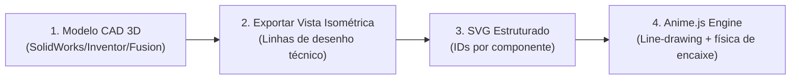
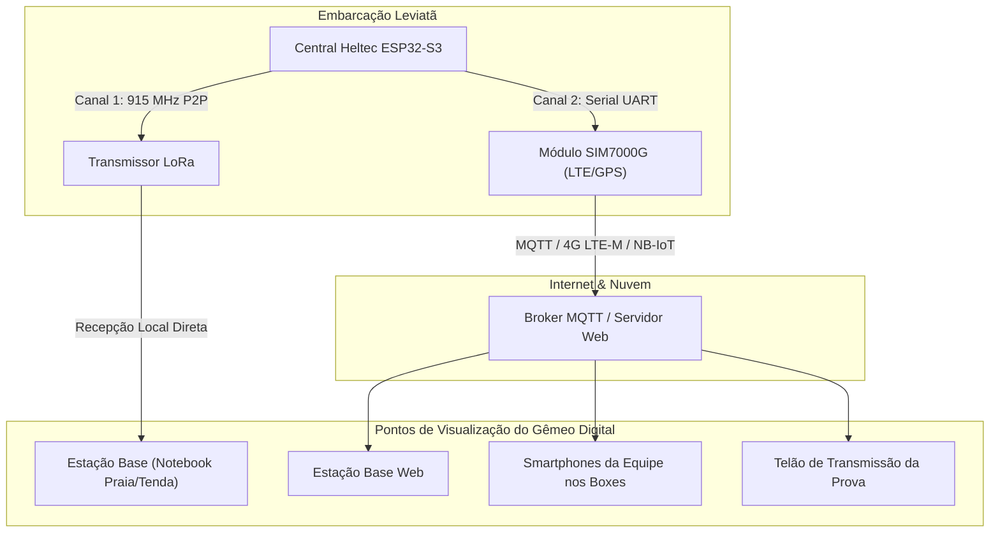

# Telemetria Leviatã 2027: Gêmeo Digital & Nova Arquitetura de Comunicação

Este documento estabelece o planejamento de viabilidade, engenharia e arquitetura para a **Telemetria 2027** da equipe Leviatã. O objetivo central é a evolução do sistema de monitoramento tradicional para um **Gêmeo Digital (Digital Twin) Interativo**, combinando a precisão do modelo CAD com o poder de animação vetorial do **Anime.js** e comunicação híbrida de alta performance (**LoRa + Celular SIM7000G**).

---

## 1. Visão Geral do Projeto

O Gêmeo Digital do Leviatã 2027 operará em **dois modos complementares**:

```
+-------------------------------------------------------------------------+
|                         GÊMEO DIGITAL LEVIATÃ 2027                      |
+------------------------------------+------------------------------------+
| Modo 1: Tour de Montagem Explicativo | Modo 2: Operação em Tempo Real    |
| (Assembly Walkthrough & Exploded)   | (Live Telemetry Digital Twin)      |
| • Do volante até o casco completo  | • Sincronizado aos sensores reais  |
| • Efeito blueprint / wireframe     | • Rotação de hélice & ângulo leme  |
| • Foco técnico, didático e bancas  | • Mapa térmico e fluxo de energia  |
+------------------------------------+------------------------------------+
```

---

## 2. Parte 1: Pipeline Gráfico (Do CAD 3D ao Anime.js)

Para atingir a estética visual moderna e futurista (inspirada na homepage oficial do **Anime.js**) sem sobrecarregar navegadores com engines 3D pesadas, adotamos o pipeline **CAD-to-Vector**:



### 2.1. Como funciona a conversão das peças
1. **Origem Fidedigna (CAD):** As peças reais já modeladas pela equipe de mecânica/naval (volante, cubo de direção, cabos de comando, leme, motor, hélice, bancos de bateria, suportes e casco) são posicionadas na vista isométrica desejada.
2. **Exportação Técnica:** A montagem é exportada em desenho 2D com linhas visíveis (formato vetorial DXF, PDF ou SVG).
3. **Organização Semântica:** No software de vetorização (Illustrator, Figma ou Inkscape), cada subsistema recebe um ID específico:
   * `#g-volante` e `#g-cubo-direcao`
   * `#g-cabos-comando` e `#g-leme`
   * `#g-motor` e `#g-eixo-helice`
   * `#g-banco-baterias` e `#g-painel-solar`
   * `#g-casco-inferior` e `#g-deck`

### 2.2. Efeitos Técnicos com Anime.js
* **Efeito Traçado a Laser (*Line Drawing*):** Através da propriedade `strokeDashoffset`, os contornos das peças se desenham suavemente do nada, dando o aspecto de blueprint animado.
* **Física de Encaixe (*Easing Elastic*):** Peças deslizam pelo eixo isométrico e se acoplam com leve amortecimento mecânico (`easeOutElastic` ou `easeOutExpo`).
* **Storytelling / Linha do Tempo (`anime.timeline`):** Controles de *Play*, *Pausar*, *Avançar Etapa*, *Voltar* e *Explodir Montagem*, sincronizados com cards explicativos de cada sistema da embarcação.

---

## 3. Parte 2: Arquitetura de Comunicação (LoRa + SIM7000G)

Para alimentar o gêmeo digital com dados contínuos, adotamos uma estratégia de **redundância híbrida**:



### Vantagens do Módulo SIM7000G:
1. **Acesso Global sem Fio:** O gêmeo digital pode ser acessado de qualquer navegador, dentro ou fora da raia de prova.
2. **Taxa de Atualização Rápida:** Transmissão a **5–10 Hz** (via MQTT), garantindo animações ultra suaves e sem solavancos.
3. **GNSS/GPS Integrado:** Receptor de satélites nativo de alta precisão (latitude, longitude, velocidade *SOG* e curso *COG*).
4. **Redundância:** O rádio LoRa permanece ativo como canal de emergência direto para a tenda caso haja sombra de sinal celular na represa/mar.

---

## 4. Diagnóstico: O que reaproveitamos de 2026 vs. O que entra em 2027

A arquitetura de 2027 reaproveita toda a fundação sólida construída em 2026:

### ✅ Já existente e reaproveitado da Telemetria 2026:
* **Leitura do Motor (Fardriver via UART):**
  * `motor_rpm` $\rightarrow$ Controla rotação contínua da hélice.
  * `motor_corrente_a` e `motor_v` $\rightarrow$ Cálculo de potência instantânea do trem de força.
  * `motor_temp_c` e `ctrl_temp_c` $\rightarrow$ Mapa de calor e alertas térmicos sobre o motor/controlador.
  * `far_falha` $\rightarrow$ Alerta visual localizado diretamente sobre a peça com falha.
* **Leitura Solar e Baterias (Victron MPPT via VE.Direct):**
  * `solar_p_w`, `solar_v_v`, `solar_i_a` $\rightarrow$ Animação de fluxo elétrico fluindo das placas para os barramentos.
  * `bateria_v` $\rightarrow$ Indicador de nível e coloração dinâmica do banco de baterias no casco.
* **Navegação (GPS TinyGPS++):**
  * `lat`, `lng`, `vel_kmh`, `gps_course` $\rightarrow$ Rumo de navegação da proa e mapa de trajetória.
* **Infraestrutura Web Base:**
  * Backend Node.js com SQLite e distribuição em tempo real via **Socket.IO**.
  * Frontend React estruturado com Tailwind CSS.

---

### 🚀 Novas adições para a Telemetria 2027:

| Subsistema | Nova Adição de Hardware / Sensor | Impacto no Gêmeo Digital |
| :--- | :--- | :--- |
| **Direção / Leme** | Potenciômetro linear no leme ou encoder magnético no volante | O volante na tela gira no ângulo exato do piloto e a pá do leme deflete em tempo real. |
| **Atitude do Casco** | IMU de 6 ou 9 eixos (MPU6050 ou BNO055 via I2C) | O casco inclina na tela respondendo ao *Roll* (balanço lateral) e *Pitch* (arfagem) nas ondas. |
| **Segurança de Porão** | Boias de nível / Sensores ópticos de água no porão | O ponto exato do fundo do casco pisca em vermelho se houver alagamento detectado. |
| **Comunicação IoT** | Módulo celular SIM7000G (LTE-M / NB-IoT) | Conexão à nuvem sem fio via MQTT e pacote de alta frequência. |
| **Interface Frontend** | Módulo `DigitalTwinView.jsx` integrado com `animejs` | Tela dedicada integrando a animação da montagem com o espelho em tempo real dos dados via Socket.IO. |

---

## 5. Próximos Passos e Roteiro de Execução

1. **Sprint Gráfica (CAD & SVG):**
   * Selecionar as peças no software CAD.
   * Exportar a vista isométrica em formato vetorial com espessuras de linha padronizadas.
   * Limpar o SVG no Illustrator/Figma e nomear os grupos com IDs claros.
2. **Sprint de Hardware & Firmware:**
   * Integrar a leitura do sensor de ângulo do leme e da IMU no ESP32-S3.
   * Adicionar os novos campos à `struct_telemetry`.
   * Realizar testes em bancada do SIM7000G transmitindo via MQTT para o servidor.
3. **Sprint Frontend (Anime.js + Socket.IO):**
   * Implementar o componente de montagem passo a passo guiada.
   * Interpolar a chegada de pacotes da telemetria nas propriedades das peças do SVG para movimentos suaves a 60 FPS.

