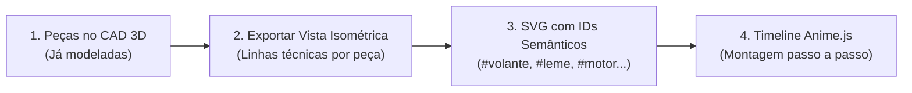

# Telemetria Leviatã 2027: Gêmeo Digital 3D, Site Didático & Arquitetura Híbrida (LoRa + SIM7000G)

Este documento estabelece o planejamento de viabilidade, arquitetura e engenharia para a **Telemetria 2027** da equipe Leviatã. O projeto é dividido em **duas frentes visuais independentes**, alimentadas pela arquitetura de comunicação dupla já existente no barco (**Heltec ESP32-S3 LoRa + Gateway LilyGO T-SIM7000G LTE/MQTT**), e otimizado para rodar em notebooks com vídeo integrado (Ryzen 7).

---

## 1. Visão Geral: Divisão em Dois Projetos

Para manter a estação de telemetria focada na operação de corrida e, ao mesmo tempo, ter uma apresentação didática de alto impacto para bancas, patrocinadores e novos membros, a visualização é dividida em duas frentes:

| Projeto | Foco Principal | Rota Gráfica | Onde Roda |
| :--- | :--- | :--- | :--- |
| **Frente 1: Site Didático da Montagem** *(Leviatã Showcase)* | Explicar passo a passo cada subsistema da embarcação, **do volante até o barco completo** | **Rota B: SVG Vetorial + Anime.js** (estilo blueprint/wireframe com traçado a laser) | Site estático independente (GitHub Pages / Vercel), acessível via QR Code no celular ou PC |
| **Frente 2: Gêmeo Digital 3D na Telemetria** *(Estação Base)* | Espelhar o estado físico, térmico e energético do barco **em tempo real** durante a navegação | **Rota A: Barco 3D Completo (glTF simplificado + Three.js)** com câmera panorâmica 360° | Integrado ao dashboard React + Node.js + Socket.IO da Estação Base (Local e Nuvem) |

---

## 2. Frente 1: Site Didático da Montagem (Rota B — SVG + Anime.js)

Um site público e leve, focado exclusivamente na engenharia e montagem da embarcação.



### Como funciona:
1. **Exportação por Peça:** Cada conjunto do CAD (volante, cubo de direção, cabos de comando, leme, motor, eixo/hélice, baterias, painéis solares e casco) é exportado na mesma perspectiva isométrica como linhas vetoriais (SVG).
2. **Estética Anime.js:**
   * `strokeDashoffset`: o contorno de cada peça é desenhado na tela antes de ela se encaixar.
   * `anime.timeline()`: permite dar *Play*, *Pause*, avançar/voltar etapa por etapa ou acionar a *Vista Explodida*, sincronizado com cards explicativos sobre o componente.
3. **Consumo de Hardware:** Praticamente zero (arquivos de poucos kilobytes que rodam a 60 FPS em qualquer celular ou notebook).

---

## 3. Frente 2: Gêmeo Digital 3D na Telemetria (Rota A — glTF + Three.js)

Dentro da Estação Base Web, uma aba dedicada exibe o **barco 3D completo** conectado aos pacotes recebidos em tempo real.

### 3.1. Regras de Otimização para Notebook sem GPU Dedicada (Vídeo Integrado)
Para rodar liso e sem drenar bateria no notebook da equipe:
1. **Malha Simplificada (*Low-Poly* Técnico):** Exportar a montagem do CAD para `.glb/.gltf` removendo roscas, parafusos internos e detalhes invisíveis, mantendo o modelo total abaixo de **50 mil a 100 mil triângulos**.
2. **Visual Técnico / Wireframe Flat:** Não usar sombras complexas, reflexos de água ou pós-processamento pesado. Usar materiais *flat/wireframe* sobre fundo escuro (mantendo a identidade visual do site didático com custo mínimo de GPU).
3. **Limitação de DPR e Render sob Demanda:** Travar a densidade de pixels em `1–1.5` e atualizar quadros apenas quando a câmera se mover ou chegar pacote novo da telemetria.

### 3.2. Convenção Única de Nomes (CAD $\rightarrow$ SVG $\rightarrow$ 3D)
Usar os mesmos identificadores nos nós do arquivo `.glb` e nos grupos do `.svg`:
* `part_volante` / `part_cubo_direcao`
* `part_leme`
* `part_motor` / `part_helice`
* `part_baterias` / `part_mppt` / `part_paineis`
* `part_casco`

---

## 4. Arquitetura de Comunicação Dupla (LoRa + LilyGO SIM7000G)

A embarcação já conta com dois módulos trabalhando em conjunto (`Firmware Heltec esp32 LoRa sx1276` + `Firmware lilygo esp32 sim7000g`), formando uma arquitetura de **telemetria híbrida redundante**:

```mermaid
flowchart TD
    subgraph Embarcacao [Embarcação Leviatã]
        Sensores["Fardriver + Victron MPPT + GPS + IMU/Leme"] --> Hub["Hub Central: Heltec ESP32-S3"]
        Hub -->|1. Rádio 915 MHz P2P| LoRaTX["LoRa SX1262/SX1276"]
        Hub -->|2. ESP-NOW Local (Alta Velocidade)| LilyGO["Gateway LTE: LilyGO T-SIM7000G"]
    end

    subgraph Canais [Transmissão Simultânea]
        LoRaTX -->|Sinal Direto s/ Internet| BaseSerial["Receptor LoRa USB na Tenda"]
        LilyGO -->|LTE / GPRS — MQTT JSON| Broker["Broker MQTT na Nuvem\n(leviata/telemetria/race)"]
    end

    subgraph Estacoes [Consumo pelo Gêmeo Digital 3D]
        BaseSerial --> NodeBackend["Backend Node.js + Socket.IO"]
        Broker --> NodeBackend
        Broker --> AcessoRemoto["Acesso Remoto (Boxes / Telão / Celulares)"]
        NodeBackend --> Gemeo3D["Gêmeo Digital 3D (React + Three.js)"]
    end
```

### Papel estratégico do SIM7000G junto ao LoRa em 2027:
1. **Ponte para a Nuvem (`LilyGO T-SIM7000G`):**
   * Recebe a `struct_telemetry` do Hub Heltec via **ESP-NOW** instantaneamente dentro do barco, converte para JSON estruturado (`solar`, `bateria`, `prop`, `nav`, `sinal`, `v_sist`) e publica via **MQTT** (`leviata/telemetria/race`).
   * Permite que o Gêmeo Digital 3D seja alimentado via internet de qualquer lugar, além de monitorar a tensão de bateria do próprio sistema (`BAT_ADC`).
2. **Desacoplamento de Taxa de Envio (Melhoria de Firmware para 2027):**
   * *Como está em 2026:* No `Firmware_LoRa_Central_Hub.ino`, o comando `esp_now_send(lilygoAddress, ...)` está preso dentro do `if (millis() - lastSend > 5000)` do LoRa SF12.
   * *Evolução para 2027:* Separar o timer do `esp_now_send` do timer do LoRa! Assim, a Heltec envia dados via ESP-NOW para o **SIM7000G a cada 500ms–1s** (alta frequência para o Gêmeo Digital via MQTT), enquanto o LoRa transmite no seu próprio ritmo (também otimizado para `SF7/SF8`).
3. **Fusão no Backend Node.js:**
   * O `server.js` da Estação Base Web pode receber pacotes tanto da **Porta Serial (LoRa)** quanto do **Broker MQTT (SIM7000G)**, usando o dado mais recente disponível sem interrupção se um dos canais oscilar.

---

## 5. Diagnóstico de Sensores: O que já temos vs. O que entra em 2027

### ✅ O que já existe em 2026 (no Heltec + LilyGO SIM7000G) e alimentará o Barco 3D:
* **Controlador Fardriver (`serialFar`):**
  * `motor_rpm` $\rightarrow$ Rotação proporcional da hélice 3D.
  * `motor_corrente_a` e `motor_v` $\rightarrow$ Indicador de potência elétrica consumida.
  * `motor_temp_c` e `ctrl_temp_c` $\rightarrow$ Mudança de cor térmica direto no bloco do motor/controlador 3D.
  * `far_falha` $\rightarrow$ Destaque piscante em vermelho na peça com código de erro.
* **Controlador Solar Victron MPPT (`serialMPPT` — VE.Direct) & BMV:**
  * `solar_p_w`, `solar_v_v`, `solar_i_a` $\rightarrow$ Indicador visual de geração nos painéis solares 3D.
  * `bateria_v` / `soc` / `corrente_liq` $\rightarrow$ Estado de carga e cor do banco de baterias interno.
* **GPS (`serialGPS` — TinyGPS++):**
  * `lat`, `lng`, `vel_kmh`, `gps_course` (`proa`) $\rightarrow$ Orientação de proa do barco 3D e mapa.

### 🚀 Novas adições para fechar o Gêmeo Digital 2027:

| Subsistema | O que adicionar / ajustar | Resultado no Gêmeo Digital 3D |
| :--- | :--- | :--- |
| **1. Timer Independente ESP-NOW $\rightarrow$ SIM7000G + LoRa SF7/SF8** | Desacoplar o envio ESP-NOW do LoRa no firmware da Heltec e reduzir o SF do LoRa | Atualização rápida (0,5s a 1s) tanto via **MQTT (SIM7000G)** quanto via **LoRa**, deixando o Barco 3D totalmente fluido. |
| **2. Integração MQTT nativa no Backend Node.js** | Conectar o `backend-node` ao tópico `leviata/telemetria/race` em paralelo à Serial | O Gêmeo Digital 3D funciona automaticamente via 4G/SIM7000G ou via LoRa USB sem precisar trocar de tela. |
| **3. Sensor de Ângulo de Direção/Leme** | Potenciômetro linear no leme ou encoder no eixo do volante | Volante e pá do leme giram no modelo 3D no mesmo ângulo físico do piloto. |
| **4. IMU (MPU6050 / BNO055 via I2C)** | Leitura de *Roll* (balanço lateral) e *Pitch* (arfagem) | O casco 3D inclina em tempo real acompanhando as ondas. |
| **5. Sensor de Porão (Boia)** | Pino digital no ESP32 detectando água no fundo do casco | Alarme visual piscando no fundo do casco 3D. |

---

## 6. Roteiro Prático de Execução

1. **Etapa 1 — Firmware & Comunicação (Heltec + SIM7000G):**
   * Separar o timer do `esp_now_send` (para alimentar o LilyGO SIM7000G em alta frequência) e ajustar o LoRa para `SF7/SF8`.
   * Adicionar cliente MQTT no `backend-node` para receber o tópico `leviata/telemetria/race` do SIM7000G junto com a Serial LoRa.
2. **Etapa 2 — Protótipo Gráfico de Validação (3 peças):**
   * Exportar **volante, leme e hélice** do CAD (em SVG para o site didático e em GLB simplificado para a telemetria) e validar a fluidez no notebook Ryzen 7.
3. **Etapa 3 — Site Didático da Montagem (Rota B):**
   * Exportar todas as peças em SVG e construir a linha do tempo explicativa com Anime.js.
4. **Etapa 4 — Barco 3D Completo na Telemetria (Rota A) + Novos Sensores:**
   * Integrar o modelo 3D leve na Estação Base e incluir os campos de ângulo de leme, IMU (*roll/pitch*) e boia de porão na `struct_telemetry` (Heltec e LilyGO SIM7000G).
